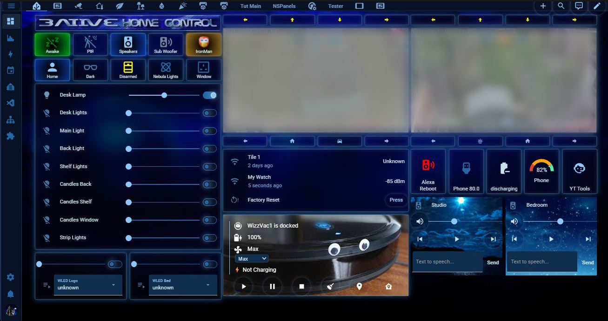
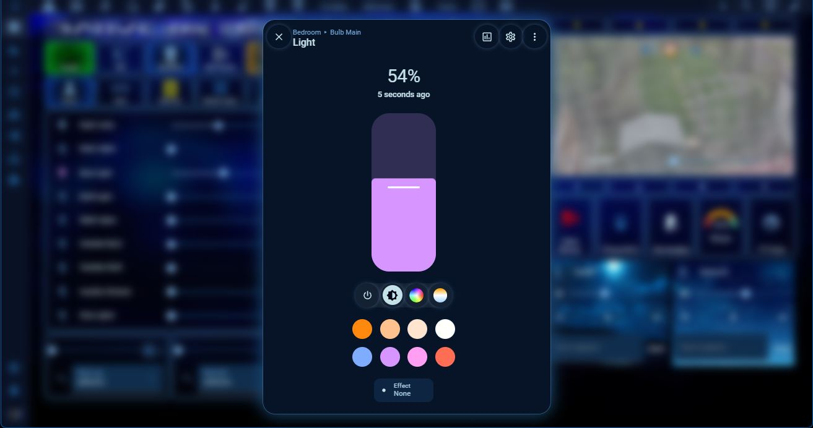
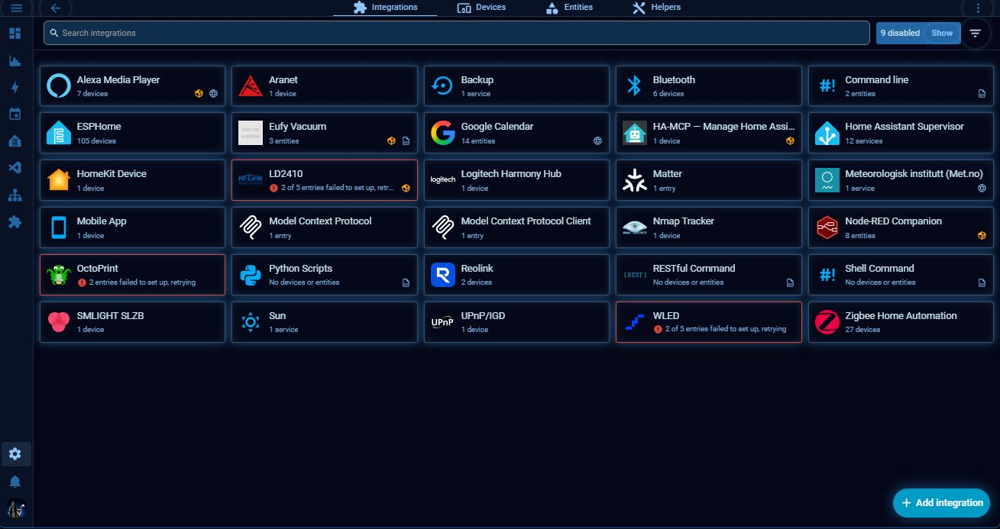
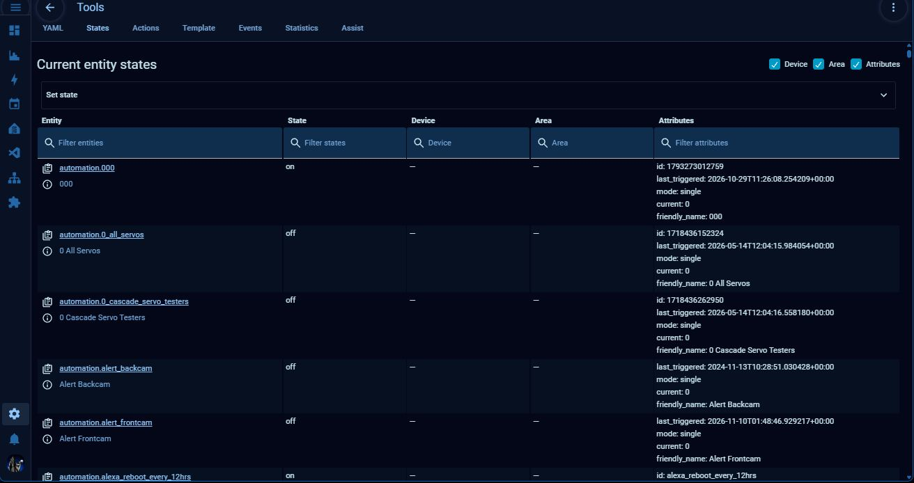

# 3ATIVE SiFi 01

[](https://hacs.xyz)
[](https://github.com/3ative/3ative-sifi-theme/actions/workflows/validate.yaml)

A sci-fi control-room theme for Home Assistant: deep navy panels, a signature
blue accent, glowing cards, switches, buttons and dialogs, and frosted-glass
cards that let a background image show through behind your dashboard.

Dark-only by design. The glow look doesn't translate to a light background,
so this theme has no light mode.



| Frosted pop-up over a blurred dashboard | Devices & services |
|---|---|
|  |  |



## Installation

### HACS

1. Open HACS and search for **3ATIVE SiFi 01**.
   (If it isn't listed yet: HACS > three-dot menu > **Custom repositories**,
   add `https://github.com/3ative/3ative-sifi-theme` with type **Theme**.)
2. Install it.
3. Restart Home Assistant, or call the `frontend.reload_themes` action.
4. Go to your profile and pick **3ATIVE SiFi 01** as your theme.

### Manual

1. Copy `themes/3ative_sifi_01.yaml` into your `config/themes/` folder.
2. Make sure your `configuration.yaml` includes:
   ```yaml
   frontend:
     themes: !include_dir_merge_named themes
   ```
3. Restart Home Assistant, or call the `frontend.reload_themes` action.
4. Go to your profile and pick **3ATIVE SiFi 01** as your theme.

## Background images (optional, but recommended)

The frosted-glass cards are 85% see-through with a backdrop blur, so they
look their best over a background image. The theme defines three variables
you can use on any dashboard view:

| Variable | Image |
|---|---|
| `--background-image-main` | `3ative_bg.jpg` |
| `--background-image-main2` | `3ative_bg_code.jpg` |
| `--background-image-main3` | `3ative_bg_code.jpg` (swap in your own for a third look) |

**To use them:**

1. Download the two images from this repo's [`images/`](images/) folder.
2. Copy them into your `config/www/` folder, keeping the exact filenames.
   Home Assistant serves `www/` at `/local/`, which is where the theme looks
   for them (`/local/3ative_bg.jpg`, `/local/3ative_bg_code.jpg`).
3. Edit a dashboard view and set its **Background** to
   `var(--background-image-main)`, or in YAML:
   ```yaml
   views:
     - title: Overview
       background: var(--background-image-main)
   ```
4. Want your own photo? Point any of the three variables in
   `3ative_sifi_01.yaml` at your own file under `/local/...`.

## Notes

- Built around the two signature blues from the older 3ATIVE blue-glass theme.
- Colours are defined once in a small palette at the top of the file, with
  see-through tints built from it using `color-mix()`, so changing one palette
  entry recolours the whole theme.
- State, graph-line and thermostat colours stay solid, because Home Assistant
  reads those in JavaScript, which can't resolve `color-mix()`.
- Slider thumbs and tile-card sliders use fixed shadows in Home Assistant, so
  they can't glow from a theme alone (that needs card-mod).

## More from 3ATIVE

Home Assistant, ESPHome and electronics tutorials on
[YouTube](https://www.youtube.com/3ative/videos).
